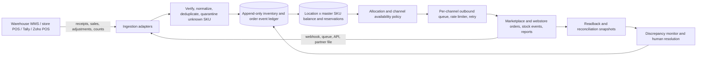
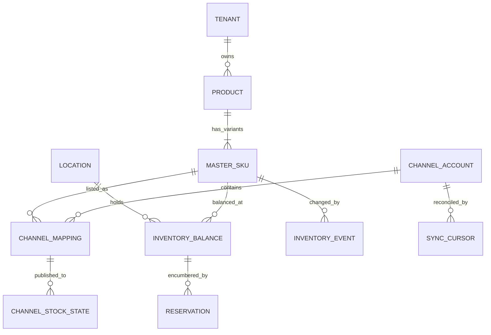

# Centralized multi-channel inventory: architecture and API discovery

**Status:** discovery blueprint, 24 September 2026. No connector, credential flow, or stock write has been implemented by this document. Frequencies below are proposed starting policies, not platform promises. Partner contracts and tenant-specific permissions must be verified before activation.

## 1. Operating model and data flow

The core owns **seller-controlled stock**. A physical receipt, POS sale, return inspection, warehouse move, or order reservation changes its ledger. Channel observations do not automatically overwrite it; they update a separate observed-channel state and trigger reconciliation. An explicit ownership policy distinguishes merchant-fulfilled inventory from stock held and controlled by a marketplace or dark store. For example, Amazon FBA inventory should be observed in the FBA Inventory API, not counted again as warehouse stock; Blinkit-supplied stock may become a separate custody location after a confirmed transfer. [Amazon FBA Inventory API](https://developer-docs.amazon.com/sp-api/lang-en_EN/docs/fba-inventory-api), [Blinkit Seller Hub](https://seller.blinkit.com/).

**Write path:** ingest a signed/authorized event; resolve its tenant, channel, seller account, external item, and external location; reject ambiguous SKU matches; persist raw reference and idempotency key; apply a conditional balance or reservation transition; commit ledger and new balance atomically; recompute sellable allocations; enqueue only changed channel targets; record acceptance, processing result, and eventual readback. Never infer that a successful HTTP request means inventory is live: asynchronous feeds and listing updates need result checks. [Snapdeal inventory workflow](https://sellerapis.snapdeal.com/reference/description-4).

**Read path:** receive webhooks or queue notifications for low-latency changes, then perform scheduled order/stock reconciliation using per-connector watermarks and paginated/bulk reads. A missed event, delayed file, expired token, or failed webhook must raise connector staleness before more sellable stock is offered. Amazon supports Notifications API delivery through SQS/EventBridge and an MFN quantity-change notification; Shopify has `inventory_levels/update` and order webhook topics; WooCommerce has signed order/product webhooks. [Amazon notifications](https://developer-docs.amazon.com/sp-api/docs/notification-type-values), [Shopify webhook topics](https://shopify.dev/docs/api/admin-graphql/latest/enums/WebhookSubscriptionTopic), [WooCommerce webhooks](https://developer.woocommerce.com/docs/apis/rest-api/v2/webhooks).

### Availability rules

For each `(tenant, master SKU, physical location)`, track `on_hand`, `reserved_order`, `reserved_cart_if_observable`, `damaged`, `quarantined`, and `safety_stock`. Set `sellable = max(0, on_hand - reserved_order - reserved_cart_if_observable - damaged - quarantined - safety_stock)`. Cart reservations exist only when a channel exposes reliable cart events or the sale originates in an owned checkout; marketplace carts should **not** be guessed. `Out of Stock` is a derived state when the publishable allocation is zero. Maintain a distinct `published_available` and `observed_available` by channel listing and external location. A channel cap or allocation percentage can reduce publishable quantity but must never increase it above source sellable stock. Use a shared pool with conditional reservations or dedicated channel/location partitions; do not publish the same unreserved unit independently to several channels without an oversell buffer.

Order reservation lifecycle: reserve on accepted order, release on verified cancellation, consume at dispatch/POS completion, return to stock only after receipt and quality check. Dedupe by `(tenant, channel account, external order, line, event type/version)` and reject a duplicate ID carrying different content. Channel events can arrive out of order; compare platform revision/time plus status transition rules, then reconcile uncertain cases. Keep quantity as integer base units; support bundle/BOM conversion and unit-of-measure conversion explicitly.

## 2. Connector discovery matrix

“Polling” is a **proposed starting interval** for active SKUs/orders, subject to tenant volume, observed freshness, API budgets, and partner approval. `Unknown` means no defensible public numeric limit was found; it does not mean unlimited.

| Channel                      | Authentication and stock interface                                                                                                                                                            | Change signal / proposed reconciliation                                                                 | Published constraint or access gap                                                                                                                                                                                                                                                                                                                                                                                                                                                                           |
| ---------------------------- | --------------------------------------------------------------------------------------------------------------------------------------------------------------------------------------------- | ------------------------------------------------------------------------------------------------------- | ------------------------------------------------------------------------------------------------------------------------------------------------------------------------------------------------------------------------------------------------------------------------------------------------------------------------------------------------------------------------------------------------------------------------------------------------------------------------------------------------------------ |
| Amazon seller-fulfilled      | SP-API LWA OAuth authorization/refresh token; Listings Items `getListingsItem` / `searchListingsItems` with `fulfillmentAvailability`; `patchListingsItem` or JSON listings feed for writes.  | MFN quantity/order notifications via SQS/EventBridge; 15–30 min incremental, nightly full/readback.     | `searchListingsItems`: default 5 requests/s, burst 5; `patchListingsItem`: 5/s, burst 10. Actual usage plan can differ; honor `x-amzn-RateLimit-Limit`. [Auth](https://developer-docs.amazon.com/sp-api/docs/connecting-to-the-selling-partner-api), [read](https://developer-docs.amazon.com/sp-api/lang-en_EN/reference/searchlistingsitems), [write](https://developer-docs.amazon.com/sp-api/lang-en_EN/reference/patchlistingsitem-1).                                                                  |
| Amazon FBA                   | Same authorized SP-API app; FBA Inventory `getInventorySummaries` for Amazon-held stock.                                                                                                      | 30–60 min or report cadence after capability check; separate custody ledger.                            | Role and operation-specific limits must be read from granted usage plan; FBA stock is observational for seller allocation. [FBA API](https://developer-docs.amazon.com/sp-api/lang-en_EN/docs/fba-inventory-api).                                                                                                                                                                                                                                                                                            |
| Flipkart                     | Seller Developer Access; OAuth client credentials for self-access or authorization-code flow for third-party; Listing v3 GET by SKU and POST inventory update; seller FTP is also documented. | Order pull plus 15–30 min listing reconciliation; nightly bulk/FTP if contracted.                       | Public docs list endpoints, but no universal numeric quota verified; obtain production quota from seller/partner access. [Auth](https://seller.flipkart.com/api-docs/FMSAPI.html), [listing API](https://seller.flipkart.com/api-docs/listing-api-docs/v3/Overview.html).                                                                                                                                                                                                                                    |
| Myntra                       | MMIP partner API access; facility-wise absolute inventory push and Inventory Reconciliation API for readback.                                                                                 | Partner order callbacks, 15–30 min selected-SKU reconciliation and daily full.                          | PPMP V4 documents push batches of 10, **100 requests/minute**, and says push quantity includes open-order inventory until ready to dispatch; recon lookup supports batches of 40. Verify the seller's PPMP/Omni contract before applying this semantic. [PPMP V4](https://mmip.myntrainfo.com/documentation/myntra-ppmp-api-v4), [MMIP updates](https://mmip.myntrainfo.com/documentation/whats-new).                                                                                                        |
| AJIO                         | Seller Central access; request approved API/EDI/SFTP schema and credentials from onboarding team.                                                                                             | If approved, ingest order feed and reconcile stock every 15–60 min; otherwise controlled report import. | Seller portal is public, but a seller-stock API contract and quota were not verified. Do not assume an endpoint or automate the portal. [AJIO Seller Central](https://seller.ajio.com/ajiocommerce/).                                                                                                                                                                                                                                                                                                        |
| LimeRoad                     | Vendor portal/partner arrangement; request approved feed/API or export format.                                                                                                                | File/report reconciliation on agreed cadence, initially hourly/daily.                                   | Vendor terms require updating unavailable stock, but no public seller API or quota was verified. [Vendor terms](https://www.limeroad.com/Vendor_Terms_Conditions.pdf).                                                                                                                                                                                                                                                                                                                                       |
| Meesho                       | Supplier Panel; request approved OMS/API or file-exchange contract and seller-specific credentials from Meesho.                                                                             | Authorized order/inventory export on agreed cadence until partner events/feed are approved.              | Supplier guidance identifies SKU, Meesho ID, sub-order ID and VSKU, and describes panel stock-update caps. No public self-service seller-stock API or numeric quota was verified. Do not claim live publication from a portal login. [Meesho supplier guidance](https://sites.google.com/meesho.com/updated-alc/orders-tab), [Supplier Panel](https://supplier.meesho.com/). |
| Snapdeal                     | Seller API with `X-Seller-Authz-Token`, `X-Auth-Token`, `clientId`; Get Inventory Bulk, update inventory, then feed/update result.                                                            | Seller order notifications where enabled; 15–30 min readback, daily full.                               | Bulk read accepts up to **10 SUPCs per call**; request-per-time limit not publicly verified. [Inventory read](https://sellerapis.snapdeal.com/v1.0/reference/get-inventory-bulk), [workflow](https://sellerapis.snapdeal.com/reference/api-picker).                                                                                                                                                                                                                                                          |
| Shopify                      | Merchant-approved Admin GraphQL access token with `read_inventory`/`write_inventory`; query InventoryLevel by item/location; quantity mutations with comparison/idempotency.                  | Order/inventory webhooks; 15–30 min reconciliation, bulk operation for full scans.                      | GraphQL calculated-cost restore rates: Standard **100**, Advanced **200**, Plus **1,000**, Commerce Components **2,000 points/s**; single query ≤1,000 points. Public apps need expiring offline tokens under current rules. [Auth](https://shopify.dev/docs/apps/build/authentication-authorization), [inventory](https://shopify.dev/docs/apps/build/orders-fulfillment/inventory-management-apps/manage-quantities-states), [limits](https://shopify.dev/docs/apps/build/apis/graphql-admin/rate-limits). |
| WooCommerce                  | Per-store REST consumer key/secret, HTTPS, `/wp-json/wc/v3/products` and variation stock fields.                                                                                              | Signed `order.*`/`product.*` webhooks; 15–30 min product/order reconciliation.                          | No single platform-wide WC REST quota; hosting, firewall, plugins, and WordPress policy determine throughput. The public Store API is **not** the management API. [REST auth](https://developer.woocommerce.com/docs/apis/rest-api/authentication), [products](https://developer.woocommerce.com/docs/apis/rest-api/v3/products), [webhooks](https://developer.woocommerce.com/docs/apis/rest-api/v2/webhooks).                                                                                              |
| Blinkit                      | Seller Hub; seek approved seller inventory/settlement feed or API directly from Blinkit.                                                                                                      | Partner feed/event if granted; otherwise scheduled authorized export, initially hourly/daily.           | Public Seller Hub says it manages inventory; no public seller-stock API/quota verified. [Seller Hub](https://seller.blinkit.com/).                                                                                                                                                                                                                                                                                                                                                                           |
| Zepto                        | Brand Portal and partner onboarding; request permitted inventory/report integration and custody semantics.                                                                                    | Contracted file/API cadence; initially hourly/daily.                                                    | No public seller-stock endpoint/quota verified. [Brand Portal](https://brands.zepto.co.in/), [terms](https://brands.zepto.co.in/terms-of-use).                                                                                                                                                                                                                                                                                                                                                               |
| Swiggy Instamart             | Seller/brand partner onboarding; request seller-side feed/API and dark-store ownership contract.                                                                                              | Contracted event/file cadence; initially hourly/daily.                                                  | Public consumer/enterprise Instamart APIs are **not evidence of a seller stock-write API**; no seller quota verified. [Partner page](https://www.swiggy.com/instamart-partner), [consumer API reference](https://mcp.swiggy.com/builders/docs/reference/instamart/).                                                                                                                                                                                                                                         |
| Zoho POS                     | Zoho OAuth token, organization ID, regional `api.zakya.com` or `.in`; item `stock_on_hand`, `available_stock`, `actual_available_stock`; confirm which measure drives stock.                  | 5–15 min POS item/sale pull or approved event; daily full.                                              | Published: **100 requests/minute**, plus **1,500/day Free/Trial** or **2,500/day Standard**; plan-specific higher limits need confirmation. [Zoho POS API](https://www.zoho.com/pos/resources/api/), [items](https://www.zoho.com/pos/resources/api/items.html).                                                                                                                                                                                                                                             |
| TallyPrime / other store POS | Tally XML over local HTTP (default 9000), TDL/XML exports or approved integration middleware; other POS via vendor API or outbox.                                                             | Prefer local sale commit/outbox push; 5–15 min reconciliation, daily stock count.                       | No public universal quota. Keep Tally gateway inside a private network and use a local agent; do not expose port 9000 publicly. [Tally XML integration](https://help.tallysolutions.com/xml-integration/).                                                                                                                                                                                                                                                                                                   |

For closed channels, evaluate **approved API → partner SFTP/EDI → signed scheduled report export → manual upload** in that order. Browser automation is a last-resort, separately approved arrangement only if the channel permits it; it is brittle under MFA/UI changes and must never bypass access controls. A portal lacking an approved machine interface remains a monitored manual connector, not a claimed continuous sync.

### Additional India-specific seller and network onboarding

These channels are present in the connection catalog as approval/report paths, not as proven live API connectors. Seller login pages establish account/onboarding access only; they do not establish a machine-readable inventory contract or quota.

| Channel | Verified entry path | Required before live sync | Current D-Mills handling |
| --- | --- | --- | --- |
| Tata CLiQ | [Seller Experience Zone](https://sellerzoneerp.tatacliq.com/) provides seller login and a seller pre-requisition workflow. | Obtain seller-specific order, inventory, returns, facility, write-result, and readback specifications from Tata CLiQ. | Store the onboarding reference and accept authorized reports as channel observations. No public stock API verified. |
| Nykaa Fashion | [Nykaa Seller Portal](https://seller.nykaa.com/catalogue-management/) and [Vendor Support](https://vendorsupport.nykaa.com/portal/en/home). | Ask vendor support for the authorized OMS/API or report contract, SKU/listing/location identities, stock semantics, and quotas. | Approval and report workflow only. No public seller stock-write contract or rate limit verified. |
| JioMart | [Seller login and registration](https://identity.seller.jiomart.com/sso/) identifies seller onboarding and Seller Support. | Obtain a seller-specific API, EDI, or report agreement, with order, return, facility, quantity and readback definitions. | Approval and report workflow only. No public seller inventory API verified. |
| ONDC | [Seller Network Participant information](https://ondc.org/pages/seller-network-participants.html) describes SNPs and their seller application role. | Choose to operate as an SNP or integrate through an authorized SNP; complete participant onboarding, protocol versioning, authentication/signing, callbacks, and sandbox/conformance checks. | Onboarding record/report observations only. This application has no ONDC protocol adapter; ONDC is a network, not a conventional seller portal. |

Do not mark any of these as connected from a login URL, onboarding reference, or uploaded report. Live status requires verified credentials, exact SKU and fulfillment-location mapping, implemented approved transport, event/readback evidence, and reconciliation.

## 3. Logical data model

### Programme and fulfillment variants

Amazon Now, Amazon Fresh, Flipkart Minutes, Shopsy, Myntra M-Now and bigbasket bbnow are registered as programmes attached to compatible parent seller accounts, rather than independent API integrations by default. The account-specific contract must confirm programme enrollment, order discriminator, facility identity, stock ownership, feed semantics and readback. Standard Amazon SP-API, Flipkart Seller API or Myntra PPMP authorization is not assumed to cover a quick-commerce programme. The programme configuration, report-import boundaries and code status live in the implementation guide. Programme observations are stored apart from physical balances and cannot enqueue publication. An order can receive one programme label only; order reports classify already-ingested parent orders to avoid duplicates. [Amazon Now](https://www.aboutamazon.in/news/retail/amazon-now-10-minute-delivery-launch), [Flipkart Minutes](https://stories.flipkart.com/announcement/flipkart-minutes-marks-two-years-with-4x-growth-reaches-over-150-cities), [Shopsy Seller Hub](https://seller.flipkart.com/shopsy), [Myntra MMIP](https://mmip.myntrainfo.com/documentation/myntra-ppmp-api-v4), [bigbasket bbnow](https://www.bigbasket.com/bb-now-56897/).

| Entity                        | Required fields and constraints                                                                                                                                                                                                                                                                                                                                      |
| ----------------------------- | -------------------------------------------------------------------------------------------------------------------------------------------------------------------------------------------------------------------------------------------------------------------------------------------------------------------------------------------------------------------- |
| `Product`                     | `tenant_id`, `product_id`, name, brand, category, tax/handling attributes; a parent style, not necessarily sellable.                                                                                                                                                                                                                                                 |
| `MasterSKU`                   | `tenant_id`, immutable `master_sku_id`, `product_id`, internal SKU, GTIN/barcode aliases, variant attributes, base UOM, bundle BOM, lifecycle state. Unique `(tenant_id, internal_sku)`; external IDs never become primary keys.                                                                                                                                     |
| `ChannelAccount`              | `tenant_id`, channel, seller/store identifier, marketplace/region, credential vault reference, granted scopes, fulfillment model, status, last successful sync; never raw secrets in records/logs.                                                                                                                                                                   |
| `ChannelMapping`              | `tenant_id`, `channel_account_id`, `master_sku_id`, seller SKU, listing ID, ASIN/SUPC/product/variation/item ID as applicable, external location ID, pack-size conversion, validity/status, confirmed-by and time. Unique active `(account, external item, external location)`; multiple listings may point to one MasterSKU only with explicit quantity conversion. |
| `Location`                    | `tenant_id`, internal location ID, type (`warehouse`, `store`, `marketplace_custody`, `in_transit`), parent, timezone, ownership, sellable flag; external location IDs live in a separate mapping.                                                                                                                                                                   |
| `InventoryBalance`            | `(tenant_id, master_sku_id, location_id)` unique; on-hand, reserved, damaged, quarantined, safety stock, version, last event ID. Cache of ledger, not an independent truth.                                                                                                                                                                                          |
| `Reservation`                 | Order/cart reference, quantity, source location, state, expiry only where safe, external line ID, idempotency key; unique channel order-line allocation.                                                                                                                                                                                                             |
| `InventoryEvent`              | Immutable event ID, tenant, SKU, location, delta/category, cause, external source/version/time, ingestion time, raw payload reference, actor, idempotency key. Retain audit history and replay capability.                                                                                                                                                           |
| `ChannelStockState`           | Mapping ID, target quantity, submitted quantity, accepted/pending/failed state, platform observed quantity, platform timestamp, last readback, policy version, discrepancy.                                                                                                                                                                                          |
| `SyncCursor` / `ConnectorJob` | Account, endpoint/feed, watermark, next page, quota bucket, last success/error, retry/dead-letter metadata.                                                                                                                                                                                                                                                          |

SKU mapping sequence: import each channel catalog; normalize only safe identifiers (case/whitespace rules are channel-specific); exact match verified GTIN/internal SKU; require human review for fuzzy brand/title/size candidates; record effective mapping with provenance; quarantine unknown or conflicting items and suspend stock writes for them. Keep `ASIN` (catalog identity), seller SKU (offer identity), listing ID, warehouse/facility ID, and size/pack conversion distinct. A mapping change triggers a controlled readback and reconciliation before outbound writes.

## 4. Sync controls and failure handling

1. **Ingress security:** verify webhook signatures/HMAC or provider queue authorization; encrypt credentials in a vault; minimize requested scopes; isolate tenants; use short-lived tokens and rotation. Record masked request IDs, not tokens or customer PII.
2. **Ordering and atomicity:** transactional ledger + balance + outbox commit; conditional balance version/available check on each reservation; de-duplicate webhook retries and POS outbox replay. Event time is evidence, not proof of processing order.
3. **Outbound:** coalesce changes per `(account, listing, external location)` while preserving causal audit; token-bucket per operation/account; back off on 429 and `Retry-After`; classify 4xx mapping/permission errors for review; poll feed job results and read back published quantity.
4. **Reconciliation:** compare internal publishable target with platform observation using channel-specific quantity semantics, time lag, and custody. Distinguish `pending propagation`, `stale observation`, `unmapped`, `quantity mismatch`, and `ownership mismatch`. Resolve by source correction, mapping fix, or approved republish, with an audit trail.
5. **Degraded mode:** when order intake or stock publication is stale beyond the agreed SLA, stop increases to advertised stock and alert; decide whether to reduce stock to a safe floor according to channel policy. Do not automatically overwrite a platform quantity whose semantics or ownership are uncertain.

Service objectives to agree with operators: event ingestion latency, outbound acceptance latency, platform readback latency, maximum stock-drift age, oversell rate, duplicate-event rate, connector coverage, and time to resolve discrepancies. Observability should be per tenant/account/SKU/location, with queue depth, last successful cursor, token expiry, 429 rate, and dead letters.

## 5. Phased roadmap and decision gates

| Phase                            | Deliverable                                                                                                                                             | Exit evidence                                                                                                 |
| -------------------------------- | ------------------------------------------------------------------------------------------------------------------------------------------------------- | ------------------------------------------------------------------------------------------------------------- |
| 0. Access and contract discovery | For each intended seller account, confirm fulfillment/custody model, authorized API/feed, scopes, sandbox, quotas, event semantics, and data ownership. | Signed-off connector capability sheet; unknowns remain blocked, not stubbed as connected.                     |
| 1. Data modeling                 | Master SKU and location catalogs, channel mapping workflow, ledger, reservations, balances, discrepancy schema.                                         | Real tenant sample catalog maps without ambiguous SKUs; invariants and oversell/duplicate cases defined.      |
| 2. Core inventory                | Transactional event ingestion, balance projection, conditional reserve/release, outbox, audit.                                                          | Replay and concurrent-order simulations preserve nonnegative sellable stock and idempotency.                  |
| 3. First connectors              | Start with one owned store/POS and one webstore (Shopify or WooCommerce), then Amazon MFN; obtain real sandbox/merchant authorization.                  | Inbound sale → reserve/consume → outbound update → platform readback demonstrated end to end.                 |
| 4. Marketplace expansion         | Flipkart, Myntra, Snapdeal using their actual account access and quantity semantics; AJIO/LimeRoad only after partner contract.                         | Each connector has auth refresh, quota handling, order/stock sync, result check, and reconciliation evidence. |
| 5. Quick commerce and stores     | Partner-approved Blinkit/Zepto/Instamart feed/API plus Tally/Zoho POS/local agent; separate marketplace custody.                                        | Custody transfers and per-store reconciliation proven with partner data, or manual import clearly marked.     |
| 6. Operations                    | Drift dashboard, alerting, dead-letter replay, mapping approvals, token rotation, audit and controlled rollout.                                         | Measured freshness/oversell targets and runbooks accepted by operations.                                      |

**Architecture decision to settle before implementation:** choose the first merchant and two channels, then obtain their actual seller account permissions, inventory ownership rules, SKU/location extracts, and order-event examples. That determines whether the initial shared stock pool can safely publish exact quantities or needs per-channel partitions and safety buffers.
