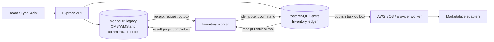

# Architecture comparison: industry patterns and OMS/WMS

Reviewed 2026-10-09. This comparison is about fit to the current code, not a platform selection. The local application is private, mixed MongoDB/PostgreSQL, React/TypeScript/Express. Any new behavior must preserve tenant-scoped Central Inventory ownership and the declared separation between commercial master data, operational stock and provider observations.

## Current architecture and boundaries

The actual service path is more nuanced than the diagram: API code may read either store; only explicit Central Inventory domain operations write physical stock. The Mongo → PG → Mongo receipt bridge relies on two local transactions and durable messages, not a shared cross-database commit. `ci_inventory_balance` is a projection of ledger events. Provider observations and publish attempts are not stock authority.

## Comparative assessment

| Pattern | Industry evidence | Existing local capability | Gap or adaptation needed | Decision |
|---|---|---|---|---|
| Immutable movement ledger with provenance | ERPNext stock ledger and reposting/test suite. | PostgreSQL inventory event/balance schema, payload-hash idempotency, nonnegative/reservation checks, event/outbox transaction. | Measure and test corrections, reconciliation and lock behavior across representative workflows. Keep financial valuation distinct unless explicitly designed. | Keep current ledger; reuse no ERPNext code absent GPL review. |
| Stable lock order for multi-row allocation | Saleor locks ordered stock rows inside atomic reservation/allocation workflows and has focused stock tests. | Local ledger serializes by SKU row, then locks the current balance row. Existing receipt/dispatch transitions call through ledger domain functions. | Multi-SKU and multi-location operations need a documented global lock order and fresh isolated contention/fault tests; source inspection alone cannot prove deadlock safety. | Adopt as a design/test criterion when extending allocation. No database framework change. |
| Explicit saga step and compensation | Medusa workflow steps reserve under a lock and provide compensation; Vendure uses explicit stock allocation strategies. | Receipt bridge already has command/result events, inbox/outbox receipts, claim leases/fencing, retries and reconciliation. | Other cross-system workflows should define command identity, ownership, compensation, uncertain provider outcomes and operator review before implementation. | Extend existing native boundary per approved workflow; do not add a second workflow engine yet. |
| Explicit transition-to-stock coupling | Vendure connects order state and stock allocation strategy; Saleor has reservation-aware availability. | Some central order and reservation paths exist; phase/evidence docs mark WMS pick-pack-handover and some partial operations as incomplete or pending decisions. | Define business event, actor authorization, line-level quantities, duplicate semantics, rollback/review status, and physical side effects before enabling legacy status mutations. | Build only after contract/owner decisions. UI labels alone do not prove execution. |
| Rich WMS lifecycle vocabulary | OpenBoxes models broad healthcare warehouse/inventory tasks. | Legacy screens/tests cover many WMS-shaped modules; ADR-001 says those records do not universally constitute authoritative operational state. | Audit one workflow at a time against source, store, API transitions and end-to-end evidence. Avoid migrating generic Mongo records by name/status alone. | Use as a gap checklist, not as a service/code port. |
| Modular Node inventory domain | Medusa modules/workflows and pg-boss show TypeScript/Postgres ecosystem options. | Existing app already has `inventory/` domain modules, PostgreSQL connection/migrations, durable outbox and SQS workers. | Minimize another framework/queue until isolated load/recovery data demonstrates a need. Define one writer and one idempotency contract for each new command. | Preserve current stack and extend it incrementally. |

## Concrete high-value gap: SKU CreateUpdate import

The source contract currently conflicts across client and server. `api/sku-imports.js` validates only metadata and deliberately returns HTTP 501 without writing rows. `src/eretail/masters/SkuImport.tsx` first fetches SKUs, then sends a POST or PUT for each parsed row, and finally posts the history record. The sequence can leave committed SKU rows before the history call rejects with 501. A current uncommitted change to the route prevents fabricated history but does not make the earlier mutations atomic; the UI presents counts based on its individual request outcomes. A source-reviewed regression file covers the server 501 boundary; it does not turn the client’s per-row operations into one atomic import.

A future design should make the server own the uploaded bytes and parsed records, impose file/row bounds, validate the entire payload and active Attribute Set, resolve duplicate keys deterministically, authorize the operation, and persist either one all-or-nothing import or durable explicit per-row outcomes according to the product contract. It should use a request/job identity for retry safety, preserve source filename/hash and actor/timestamps, and provide a recoverable outcome after timeout. It must not mutate inventory quantities. The desired partial-vs-atomic business behavior is an explicit decision; this report recommends failing the whole import if any row is invalid until operators confirm partial success is expected.

## Deployment and test implications

No upstream code or test suite was run. Existing local test scripts are not equivalent: use the repository’s disposable-stack guard and a fresh `_test` Mongo replica set/PostgreSQL database for database assertions; do not point test commands at configured stores. Current baseline reporting documents that some disposable initialization attempts fail in this environment before application tests. Any follow-on implementation must report such a failure as NOT RUN for app semantics. Add tests at route/service, concurrency/failure injection, and UI recovery levels; then run the relevant local verification plus authenticated browser workflow when the permitted harness is available.

Do not claim provider readiness from adapter files, successful synthetic fixtures, or a UI flow. Provider reads, writes, acknowledgements, readback, hosted delivery, load, restore and RPO/RTO require their own authorized evidence.

## Required module comparison matrix

Priority uses business impact, compatibility, effort and risk together: **P1** is a high-value bounded improvement or critical evidence gap; **P2** is valuable but depends on policy/workflow definition; **P3** is conditional on measured need. “Compatibility” describes pattern adoption in this stack, not drop-in code compatibility.

| My module | Recommended repository | Direct source link | Pattern to adopt | Compatibility | Priority |
|---|---|---|---|---|---|
| Central stock ledger, reservations, PostgreSQL | Saleor; ERPNext for ledger audit concepts | [Saleor warehouse management](https://github.com/saleor/saleor/blob/main/saleor/warehouse/management.py), [lock helper](https://github.com/saleor/saleor/blob/main/saleor/warehouse/lock_objects.py), [ERPNext ledger](https://github.com/frappe/erpnext/blob/develop/erpnext/stock/stock_ledger.py) | Deterministic lock order, reservation-aware allocation, auditable movements and rollback tests | High for design/test criteria; no framework replacement. Existing `inventory/ledger.js` already enforces key invariants. Independent change: test additions only. Risks: lock-order regressions/deadlocks and misleading source-only confidence. Affected files: `inventory/ledger.js`, `inventory/wms-operations.js`, `scripts/verify-ledger-input-boundary.mjs`, `scripts/measure-owned-ledger-contention.mjs`; test retry conflict, concurrent last-unit reservation, rollback and lock order on owned PG. | P1 evidence; do not rewrite core |
| Unified orders, intake and lifecycle | Medusa; Vendure | [Medusa reserve step](https://github.com/medusajs/medusa/blob/develop/packages/core/core-flows/src/cart/steps/reserve-inventory.ts), [Vendure allocation strategy](https://github.com/vendurehq/vendure/blob/master/packages/core/src/config/order/stock-allocation-strategy.ts) | Explicit transition commands, idempotency identity, compensating actions and reservation ownership | Medium: patterns fit `inventory/unified-orders.js`; foreign framework abstractions do not. Independent service-level changes are possible. Risks: provider revision ordering, stock-bound line edits, duplicate alerts and cancellation effects. Test with `scripts/verify-unified-orders.mjs` plus isolated DB replay/revision cases; browser order workflow remains separate. | P2 |
| Warehouse receipts, moves, pick/pack/dispatch | OpenBoxes; Saleor allocation tests | [OpenBoxes InventoryService](https://github.com/openboxes/openboxes/blob/develop/grails-app/services/org/pih/warehouse/inventory/InventoryService.groovy), [Saleor stock tests](https://github.com/saleor/saleor/blob/main/saleor/warehouse/tests/test_stock_management.py) | Use process vocabulary and transaction/failure matrices; model physical status changes as typed ledger-owned commands | Medium-low for direct source reuse; high for gap discovery. Affected local areas include `inventory/wms-operations.js`, `inventory/receipt-bridge.js`, `api/inbound-*`, `api/manage-picking.js`, `api/delivery-shipping.js`, `api/shipments.js` if present/mounted. | P1/P2, gated on workflow/owner decisions. Risks: double receipt, premature stock deduction, physical state mismatch and migration of ambiguous legacy records. Test existing `scripts/verify-phase-b-propagation.mjs`, inbound route verifiers, then new pick/pack/partial-dispatch failure cases on isolated Mongo+PG; current sandbox attempts may stop before app assertions. |
| SKU and product listing import/mapping | Medusa workflows; Saleor transaction testing | [Medusa compensation](https://github.com/medusajs/medusa/blob/develop/packages/core/core-flows/src/cart/steps/reserve-inventory.ts), [Saleor stock tests](https://github.com/saleor/saleor/blob/main/saleor/warehouse/tests/test_stock_management.py) | Server-owned validation, atomic commit or explicit row outcomes, stable idempotency and authoritative history | High for pattern; no copy. Current UI enforces 500 rows locally, then loops individual `/api/skus` writes before `/api/sku-imports` returns 501. A current uncommitted change to `api/sku-imports.js` has closed the false-history write, but it does not prevent preceding per-row SKU writes. Affects `src/eretail/masters/SkuImport.tsx`, `api/sku-imports.js`, `api/skus.js`, Mongo transaction abstraction and import verifiers. Independent bounded feature; risks are old-client compatibility, duplicate SKU races, unsupported Mongo transaction deployment and import-history contract. Test validation/no writes, atomic rollback, concurrent duplicate keys, same-key retry/changed-content conflict and browser timeout recovery. | **P1 highest candidate** |
| Marketplace integrations and webhooks | Shopify official Node app library; Medusa adapters as secondary architecture reference | [Shopify app JS](https://github.com/Shopify/shopify-app-js), [Shopify API package](https://github.com/Shopify/shopify-app-js/tree/main/packages/apps/shopify-api), [historical webhook guide in archived repo](https://github.com/Shopify/shopify-api-js/blob/main/packages/shopify-api/docs/guides/webhooks.md) | Verify current official package/API version, raw-body HMAC, duplicate message key, bounded retry and stable provider IDs. Local raw-body HMAC and idempotent webhook ingestion already exist; prefer targeted parity checks over replacement. | High for Shopify-specific contract discovery; medium integration cost. `inventory/http.js`, `inventory/ingress.js`, `inventory/connectors/shopify.js`, `inventory/workers.js`. `shopify-api-js` is archived; use only to trace the move and favor current `shopify-app-js`. | P1 security/evidence, P2 code change. Risks: HMAC raw-body parser order, webhook replay races, API version drift and unauthorized external writes. Existing local source already HMAC-verifies raw bodies and dedupes delivery IDs. Test forged signature, duplicate ID/same body, changed body conflict, malformed event and bounded retry with injected transports; use an authorized provider test store only for provider acceptance/readback. |
| Authentication, authorization and audit | Vendure permissioned API-key patterns; local policy audit remains authoritative | [Vendure service/API source directory](https://github.com/vendurehq/vendure/tree/master/packages/core/src/service) | Explicit permission checks on each sensitive operation, actor and reason audit, object-scope negative tests | Low-medium: framework differs; do not infer a role matrix from a commerce product. Affected `api/auth-session.js`, `server.js`, `inventory/connections.js`, `inventory/files-api.js`, tests. | P1 policy gap. Not independent of owner policy. Risks: breaking current operators or exposing tenant/object data. Affected `api/auth-session.js`, `server.js`, `inventory/connections.js`, `inventory/files-api.js`; add wrong-role, wrong-tenant, guessed-object, stale-session and audit-on-failure tests before changing grants. |
| Queues, outbox and worker recovery | pg-boss for comparison; Medusa workflow only for compensation vocabulary | [pg-boss plan source](https://github.com/timgit/pg-boss/blob/master/src/plans.ts), [Medusa reserve workflow](https://github.com/medusajs/medusa/blob/develop/packages/core/core-flows/src/cart/steps/reserve-inventory.ts) | Bounded claim batches, leases/fencing, retry backoff, poison isolation and operational metrics | High for reviewing `inventory/workers.js`, `inventory/sqs-worker.js`, `inventory/receipt-bridge.js`; low rationale to add a new queue. | P1 reliability evidence, P3 queue replacement. Independent observability/test improvements possible. Risks: competing queue ownership, duplicate dispatch and unbounded recovery. Test lease expiry/fencing, poison isolation, queue fairness and retry outcomes with fake transport plus owned DB; never infer provider completion from enqueue acceptance. |
| React frontend, WMS screens and dashboards | No reviewed repository merits wholesale UI adoption; Saleor is API-first | [Saleor warehouse tests and workflow source](https://github.com/saleor/saleor/tree/main/saleor/warehouse) | Ensure visible state reflects durable backend outcome, pending/failed recovery and permissions; test screen-to-API paths | High for local test criteria; upstream UI stack not a strong match. Areas: `src/pages/CentralInventory.tsx`, `src/pages/SellerConnections.tsx`, `src/eretail/modules/*`, `src/eretail/ScreenContext.tsx`. | P2 per workflow. Test loading/error/pending/committed states, refresh after timeout and forbidden actions in browser; do not treat component-source checks as mounted workflow evidence. |
| Security/audit, tests and CI/deployment | Local reports and verified upstream focused tests; no upstream CI transplant | [Saleor warehouse tests](https://github.com/saleor/saleor/tree/main/saleor/warehouse/tests), [Vendure current v3.7.4 release notes](https://github.com/vendurehq/vendure/releases) and [core e2e suite](https://github.com/vendurehq/vendure/tree/master/packages/core/e2e) | Tie each invariant to failure/replay/permission tests and safe disposable data; separate source, isolated, browser and hosted evidence | High for method; CI/deployment details need a separate operational fit review. `scripts/`, `render.yaml`, test reports. | P1 for gaps; production acceptance remains outstanding. Existing repo scripts and `render.yaml` need per-command/environment audit; test only on owned `_test` stores and authorized staging. |

## Ranked recommendation trade-offs

| Rank | Recommendation | Value | Compatibility | Effort | Risk | Why this rank |
|---|---|---|---|---|---|---|
| 1 | Replace per-row SKU import writes with a server-owned, validated and retry-safe import workflow, after selecting atomic-vs-partial semantics. | High: prevents silent partial master-data updates and false import history. | High with Express/Mongo. | Medium. | Medium: transaction support and caller compatibility need testing. | Direct source evidence reveals a client/server contract mismatch and a bounded route/UI scope. |
| 2 | Complete tenant/object/operation permission policy and negative tests for inventory preview/export and provider administration. | Very high security/data exposure value. | High, but roles require owner policy. | Medium-high. | High if roles are guessed; do not change until permissions are decided. | Local audit reports source gaps and labels runtime proof incomplete. |
| 3 | Complete isolated receipt, allocation and dispatch failure/concurrency evidence. | Very high stock-integrity value. | High, existing harness/domain. | Medium-high. | Medium; disposable PG/Mongo availability is constraint. | Existing code is close to industry transaction patterns, but latest baseline says some integration attempts did not reach assertions. Vendure v3.7.4 explicitly documents a prior oversell from unlocked read-modify-write, underscoring why isolated concurrent last-unit tests are a requirement here, not inferred from source shape. |
| 4 | Define one WMS physical lifecycle slice and implement only after contract approval. | High operational value. | Medium. | High. | High due status/stock coupling and owner decisions. | Broad WMS parity is incomplete; OpenBoxes is only discovery aid. |
| 5 | Improve marketplace adapter correctness from official provider contracts and authorized test accounts. | High commercial value. | Medium. | High. | High due external writes, rate limits and missing live evidence. | Existing source cannot substitute for provider authorization or production readback. |
| 6 | Consider a replacement queue/workflow library only after measured bottleneck. | Medium conditional value. | Low-medium. | High. | Medium-high migration/operational risk. | Existing outbox, worker and SQS already cover distinct native flows; no measurement establishes a need. |

For every future code change, compare current behavior to the relevant upstream path, adapt rather than copy, enumerate affected local files, state migration/security/regression risks, and run focused unit/isolated/browser tests. Detailed acceptance criteria for rank 1 are in [the implementation plan](recommended-implementation-plan.md).
