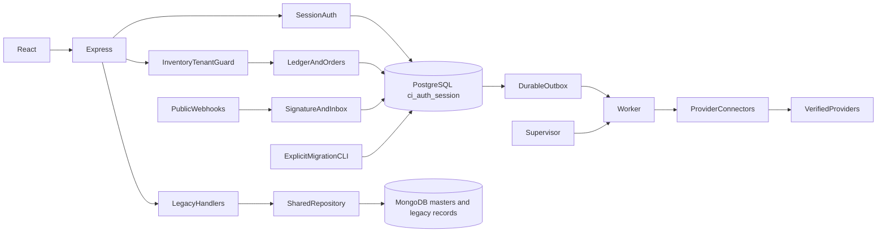

# Reliability discovery — 3 October 2026

The initial MongoDB repair was in progress when the objective expanded. A second discovery pass searched all API, inventory, frontend, worker, migration and script sources before further architecture edits. Evidence: `dependency-map.json`, `tmp/mongo-reliability/expanded-discovery.txt`, `external-call-map.txt`, `integrity-constraints.txt`.

PostgreSQL owns Central Inventory, ledger, reservations, channel mappings, provider accounts, unified orders, returns, alert teams, mobile recipients, notification state, webhook inbox, worker outbox and persistent sessions. MongoDB owns legacy/master collections including `generic_records`, `skus`, `partners`, vendors, purchase/legacy orders, legacy configuration and report sources. Mixed inbound workflows explicitly bridge Mongo receipt metadata to the PostgreSQL authority using durable request identity/replay reconciliation. Generic legacy inventory writes remain blocked.

There is one application Mongo client in `api/mongo.js` (now factored through `mongo-connection.js`) and one PostgreSQL pool in `inventory/db.js`. Diagnostic/test scripts create independent clients intentionally. Masters are global administrator records: the session identity does not carry a tenant/client claim. The application currently authenticates **all** private requests through PostgreSQL sessions. This existing authentication dependency must not be described as Mongo-only independence or changed by bypassing authentication.

Provider connectors include Shopify, Amazon, WooCommerce, Flipkart self-access connection probes, Snapdeal connection probes, Zoho POS reads, and a paired Tally bridge. Other marketplace entries do not establish a verified order/stock contract. No new provider poller or stock mutation should be inferred from catalog entries.

Inventory/outbox transactions use persisted tenant keys, unique ingress receipt identities, row locks, leases, attempt limits and replay checks. WhatsApp treats unknown send outcomes as uncertain, preventing blind retry. The worker supervisor restarts child processes; periodic account observation/reconciliation jobs are single-flight. Existing test suites already cover numerous tenant, replay, worker-crash and stock integrity boundaries; their results must remain separate from real-provider evidence.

Discovered defects include permanently rejected Mongo startup state (repaired), HTTP 500 downgrades of dependency errors (repaired), false empty grids (repair in progress), unbounded PostgreSQL acquisition/queries, absent idle-pool error handling, incomplete lifecycle/health visibility, automatic migration in deployment startup, unbounded DNS resolution in provider transport, incomplete API request metrics, missing login throttling and shared mutation-origin protection. Additional per-module concurrency/idempotency gaps require evidence-based fixes rather than a blanket successful readiness claim.

Fresh configured Atlas probe outside sandbox restrictions: TLS `ERR_SSL_TLSV1_ALERT_INTERNAL_ERROR`, alert 80, on all three servers, followed by `MongoServerSelectionError`. Configuration exists, uses mongodb+srv, has no outer whitespace, and declares a database name. This is a transport failure before a successful authenticated ping; Atlas/network remediation remains external. No credentials or hostnames are included in this evidence.
