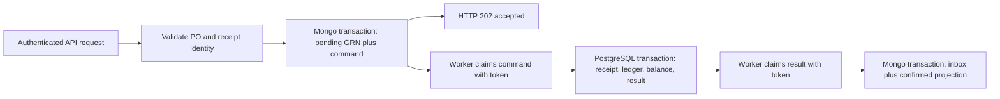

# Local inbound receipt — linked source and assertion trace

Evidence LOC-019 plus LOC-001/003/004/010. Status: source/test-assertion chain traced; runtime NOT RUN in this research phase. This is not hosted/provider or complete authorization proof.

1. server.js authenticates private legacy routes. `/api/inbound-realtime` resolves from the literal route table to api/inbound-realtime.js. Its confirmation branch validates request/fingerprint/current receipt state and returns 202 after stageReceiptCommand. A queued receipt is not stock received. Operation/warehouse permission policy is not proven by this route mount.
2. inventory/receipt-bridge.js stageReceiptCommand checks exact Central SKU/location mapping, request/source identity, PO state and authorization limits. It creates pending GRN and Mongo `_domain_outbox` in mongoDomainTransaction. api/mongo.js delegates to api/mongo-session.js withTransaction, bounded timeout and unknown-commit classification. It does not create a PostgreSQL distributed transaction.
3. Worker requires claim indexes, atomically claims ready/expired Mongo commands with generated claim_token and lease, then calls consumeReceiptCommand. It alternates ready/expired queues to avoid expired-work starvation. Completion/failure updates compare token and processing state.
4. consumeReceiptCommand validates envelope and authorization digest, locks PO authorization, verifies exact mapping, then reuses the current PostgreSQL client in receiveCentralInboundStock. domain-events.consumeEvent serializes consumer/aggregate, checks replay digest and sequence, runs effect and stores receipt/checkpoint in that same transaction.
5. Ledger inserts immutable event, changes locked balance and publication tasks; result envelope is inserted into ci_domain_outbox before the PostgreSQL transaction commits. Migrations 020 and 026 define receipt/checkpoint/outbox and claim support. This makes successful PG effects replayable, not globally exactly-once across stores/providers.
6. Result claim invokes projectReceiptResult in Mongo transaction. It checks command, causation ID, payload fingerprint and GRN/request; it updates pending GRN to committed and records result inbox digest. Duplicate result returns duplicate; changed identity conflicts. PG result acknowledgement is token-conditional.
7. Conflict/invalid-envelope work is held; dependency failures retry with bounded backoff and attempt exhaustion. EVENT_SEQUENCE is not in holdReceiptError, so a gap follows retry/exhaustion rather than advancing the checkpoint. Original request identity is essential after either store has uncertain commit.

Matching tests inspected: scripts/verify-phase-b-propagation.mjs asserts HTTP202 with no ledger event before consumption; exact request replay stages one command; thrown consumer effect leaves no receipt; injected PostgreSQL commit loss becomes DATABASE_COMMIT_UNCERTAIN and replay returns duplicate with one stock effect; result projection is idempotent; expired concurrent command/result claims recover without stock duplication; fairness at batch size one prevents expired work starving behind ready poison backlog. These are inspected assertions, not fresh PASS outcomes.

Remaining limitations: Mongo replica-set/topology and actual index state, database/process crash execution, full route permissions/actor policy, all input branches, source-to-PG authorization changes and configured backlog behavior. Inferred cross-writer lock order LOC-016 still needs investigation. External marketplace mutation is not part of this inbound bridge trace.
